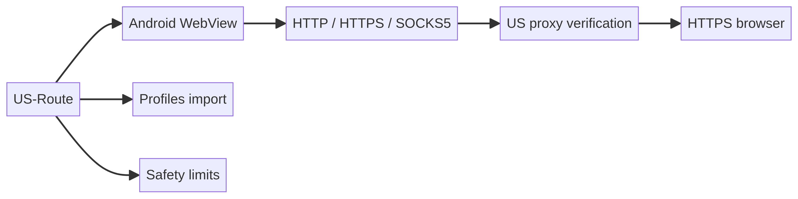

> **Status: Work in progress.** This Android prototype is published for development and review. It is not a VPN, does not guarantee anonymity, and uses public proxy infrastructure at the user's risk.

# US Route 0.3 — браузер со встроенными прокси США

Android-прототип открывает HTTPS-сайты во встроенном браузере через HTTP, HTTPS или SOCKS5 прокси с проверенным выходом США. Это **не VPN для всего телефона**: другие приложения не перенаправляются.

## Визуальное превью



Диаграмма показывает основной поток: WebView → проверка US-прокси → HTTPS-браузер, а также импорт профилей и ограничения безопасности.

## Как пользоваться

1. Установите APK. Нужен Android 8+ и актуальный Android System WebView с Proxy Override и Document Start Script.
2. При первом запуске список кандидатов **уже загружен из APK**: скачивание с GitHub не требуется. Нажмите **«Подобрать и подключить»**.
3. Приложение проверит до 60 кандидатов из встроенного снимка в 8 потоках. Проверка занимает до 70 секунд; отменённые сетевые соединения закрываются по своим тайм-аутам. Загрузка кандидатов из assets локальная, но для проверки и открытия сайтов нужен интернет.
4. После сбора результатов будет подключён US-прокси с минимальной измеренной задержкой среди завершённых проверок. Первый успех не останавливает проверку остальных. Отображаются фактический IP и задержка. Общий бюджет проверки — 70 секунд: ещё не завершившиеся проверки после этого отменяются, поэтому это не обещание самого быстрого сервера из всего репозитория.
5. Открывайте HTTPS-сайты в строке адреса. Если подходящий выход не найден, браузер остаётся заблокированным. Кнопка **«Обновить список с GitHub»** позволяет получить свежую выборку и подключиться после проверки.

Платный прокси, аккаунт и API-ключ не нужны. Ничего не покупается. Список загружается автоматически, но сетевые проверки и подключение не начинаются до нажатия «Подобрать и подключить». Если импортированы собственные сохранённые профили, они имеют приоритет. При пустом списке кнопка подключения заново читает встроенный asset, а не требует скачивания.

## Источник и проверка

В APK включён снимок US-списка из [proxifly/free-proxy-list](https://github.com/proxifly/free-proxy-list). Автор заявляет обновление каждые пять минут; это не гарантия доступности конкретного сервера или свежести CDN.

Основной адрес:
https://raw.githubusercontent.com/proxifly/free-proxy-list/main/proxies/countries/US/data.txt

Резервный адрес:
https://cdn.jsdelivr.net/gh/proxifly/free-proxy-list@main/proxies/countries/US/data.txt

Первый запуск читает `assets/us-proxies.txt` без сетевого запроса. Дата снимка, источник, число строк и SHA-256 записаны в `assets/proxy-list-source.json`. Копия лицензии источника — `assets/proxy-list-LICENSE.txt`.

Только по кнопке обновления список скачивается **напрямую** через HTTPS: GitHub или jsDelivr видит обычный IP пользователя. Этот служебный запрос не проходит через выбранный прокси. Запрещены редиректы; есть тайм-ауты и предел 1 МиБ. В выборку также включён стартовый публичный SOCKS5 `67.207.92.87:1088`, который при разработке подтвердил US и загрузку HTTPS-сайта. Если оба источника недоступны, проверяется только этот стартовый адрес; остаётся ручной импорт. Его работоспособность со временем не гарантируется: перед подключением он проходит такую же свежую проверку TLS и страны, как остальные кандидаты.

Принимаются только `http://IPv4:port`, `https://IPv4:port`, `socks5://IPv4:port`. SOCKS4, авторизация в URL, некорректные порты, локальные/private/reserved IP и дубли отбрасываются. Выборка перемешивается и распределяется между имеющимися поддерживаемыми протоколами.

Метка US в исходном списке недостаточна: каждый кандидат проверяется запросом `https://ipwho.is/` **через этот прокси**, с проверкой TLS-сертификата. Подключение разрешается только при успешном ответе со страной `US`. Геолокация приблизительная и может отличаться от определения конкретного сайта. ipwho.is видит IP выхода прокси. Если этот сервис недоступен или ограничивает запросы, кандидат будет отклонён.

Во время активности приложения повторная проверка назначается раз в три минуты; ошибки загрузки также могут запустить проверку. Это не непрерывное подтверждение страны для каждого запроса. При смене прокси старые туннели закрываются. Прямого обхода прокси для сайтов в сетевом мосте нет. Чужие сертификаты не устанавливаются, TLS-проверка не отключается.

## Важные ограничения

Публичные прокси принадлежат неизвестным операторам: они могут исчезать, тормозить, записывать адреса сайтов и метаданные соединений. Не используйте прототип для банков, паролей и личных данных. HTTPS шифрует содержимое при корректном сертификате, но не скрывает от прокси адрес назначения. Обещаний анонимности, доступа к конкретному сервису и отсутствия всех утечек нет.

HTTP и SOCKS5 не шифруют сам участок до прокси: при использовании авторизации учётные данные могут быть видны сети. Для TLS до прокси нужен поддерживаемый провайдером тип `https`; сертификаты проверяются. DNS и системные запросы Android/WebView не покрываются обещанием полного туннелирования.

Поддерживаются только HTTPS-сайты на порту 443. HTTP, внешние загрузки, основные WebRTC/WebTransport API, запросы разрешений сайтов и сетевые service workers ограничены/отключены. Часть сайтов не работает. JavaScript включён. Полный независимый аудит безопасности не проводился.

Локальный CONNECT-мост слушает случайный порт на 127.0.0.1 без собственной аутентификации. Другое приложение с сетевым доступом на этом телефоне потенциально может воспользоваться им при активном профиле. Это известное ограничение прототипа.

Встроенный снимок остаётся в APK и читается при каждом запуске, если нет сохранённых импортированных профилей. Свежая выборка после ручного обновления хранится в памяти и **не перезаписывает** собственные импортированные профили. «Удалить» очищает память, сохранённые профили и данные браузера, но не может удалить встроенный asset; он загрузится после перезапуска или нажатия подключения при пустом списке.

## Ручной импорт

Можно импортировать JSON своего провайдера — максимум 20 профилей, файл до 256 КБ. Пример в `profiles.example.json` содержит заглушки, а не рабочие серверы. Поддерживаются `http`, `https`, `socks5`, `country: US`, DNS/IPv4 и username/password. Профили шифруются AES-GCM с ключом Android Keystore; backup отключён. Импорт заменяет сохранённый список. На рутованном или заражённом телефоне защита секретов не гарантируется.

## Сборка

```sh
printf 'sdk.dir=/path/to/android-sdk\n' > local.properties
./gradlew :app:assembleRelease :app:testDebugUnitTest :app:lintRelease
```

Java 17+; Android SDK 35, Gradle 8.10.2, Android Gradle Plugin 8.8.2, AndroidX WebKit 1.12.1. APK: `app/build/outputs/apk/release/app-release.apk`. Используется тестовая debug-подпись; для публичного релиза нужен собственный постоянный ключ и аудит. Приватный ключ и пароли подписи не должны попадать в архив исходников.

Проверки и ограничения результатов описаны в `TESTING.md`. Снимок US-списка включён в APK как asset. Парсер отбирает из него до 60 поддерживаемых кандидатов, включая стартовый адрес; наличие в asset не означает успешную проверку. Обновление с GitHub остаётся дополнительной возможностью. Репозиторий источника указывает GPL-3.0; его программный код не копировался в приложение. Прототип не является официальным клиентом Proxifly. AndroidX и Kotlin runtime распространяются по Apache 2.0.
